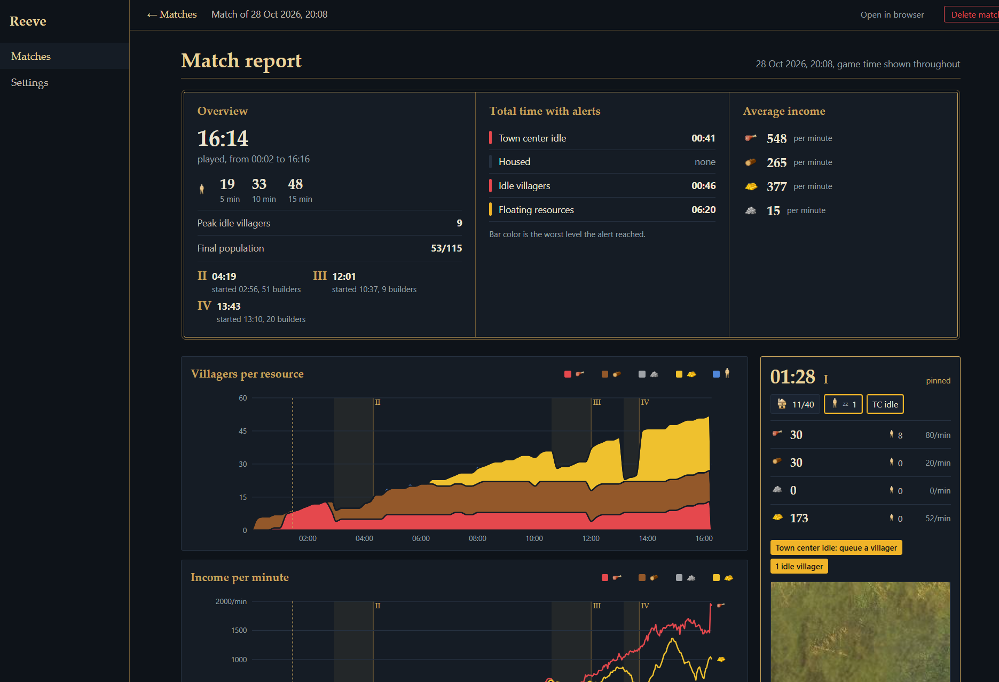
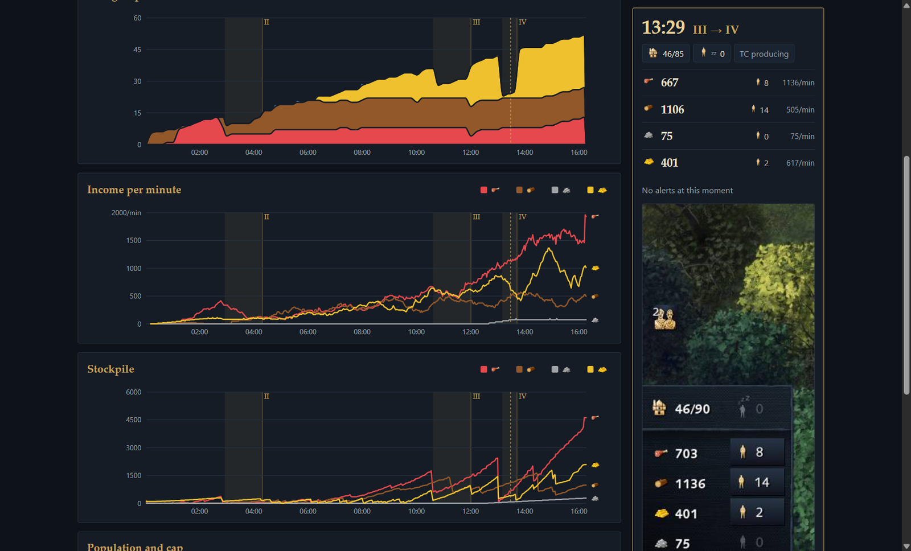
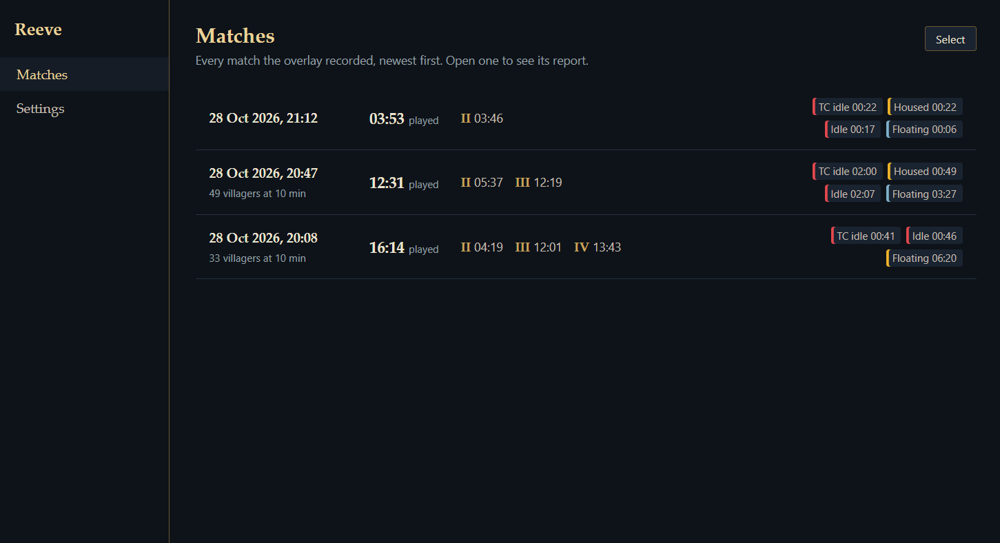
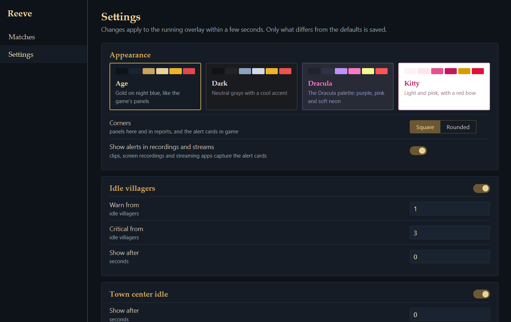

# Reeve 

A macro assistant for **Age of Empires IV**. Reeve watches your economy while you play, warns you the moment villagers go idle, your town center stops or you get housed, and gives you a full report of every match.

It reads only what the game shows on screen: no game files, no memory reading, nothing that touches the game itself.

## Features

### Live alerts
Alert cards appear over the game, each with its own sound, in three levels: **info** (blue), **warning** (yellow) and **critical** (red).

| Alert | Warning | Critical |
|---|---|---|
| Idle villagers | 1 or 2 idle | 3 or more |
| Town center not producing villagers | right away | after 10 s |
| Housed | 90% of the population cap | at the cap |
| Floating resources | above the next age's limit | two ages ahead |

Floating resources start as info above the limit of your current age: 400 in the Dark Age, 800 in the Feudal Age and 1500 from the Castle Age on. Every threshold can be changed in the hub.

### Build orders
Import a build order from [aoe4guides.com](https://aoe4guides.com) by pasting its link in the hub. During a match, the right of the screen shows its previous, current and next step: the age, the villagers and where they go (food, wood, gold, stone, building), and the step's notes with the site's icons.

- A step is reached when you have its number of villagers and its age, so the build follows your pace.
- When your villagers are not where the step puts them, a warning says what to do: **Move 1 villager from wood to food**, or **Put 2 villagers on gold** when none are left over elsewhere.
- Buildings cannot be seen by Reeve; they are part of the step's notes.
- When Reeve starts, it updates the builds their author changed on aoe4guides.com.
- In the game's menus, a card on the right of the screen picks the build for the next match, or None to show nothing.
- Steps come in, leave and move with the same animations as the alert cards.
- Above the steps, the rally point icon and where the build puts it (sheep, wood, gold...), taken from the step's notes.
- 30 seconds after the last step, the build leaves the screen and its alerts stop.
- The previous step stays for 10 seconds after a new step is reached, and the next step shows once you have been 10 seconds on the current one; both can be changed in the hub.

### Match reports
When a match ends, Reeve writes its report:

- villagers at 5, 10 and 15 minutes, when each age was reached and when its landmark started
- total time with each alert, and average income per resource
- charts over the match: villagers per resource, income per minute, stockpiles and population, with the alerts on a timeline
- click any moment to see everything that was on screen then

### The hub
Double-click the tray icon to open the hub:

- **Matches**: every recorded match, newest first, with the ages reached and the alerts of each. Open one to see its report, or select matches to delete them.
- **Builds**: import build orders from aoe4guides.com, choose the one in use, and turn the build panel on or off.
- **Settings**: turn each alert on or off and adjust its thresholds, choose the sound of each level, the volume and whether sounds repeat while an alert is active. Changes apply to the running overlay within seconds.
- **Your sounds**: add any audio or video file as an alert sound.
- **Appearance**: four themes for the hub, the reports and the alert cards (Age, Dark, Dracula and Kitty), with square or rounded corners. The alert cards show in your clips, recordings and streams; this can be turned off.

| Matches | Settings |
|---|---|
|  |  |

### Tray menu
Turn the overlay on or off, mute the sounds, open the hub, the last report or the data folder, and quit.

## Install
1. Download `Reeve-<version>-setup.exe` from the [latest release](../../releases/latest).
2. Run it. Reeve installs for your user only, no admin rights needed. Windows SmartScreen may show a warning because the app is not code-signed yet: choose **More info**, then **Run anyway**.
3. Reeve starts in the tray. Keep the option to start it with Windows and it will always be ready when you play.

### Requirements
- Windows 10 or 11, 64-bit
- Age of Empires IV in **Borderless** or **Windowed** display mode (Settings, Graphics, Display mode). Nothing can be drawn over exclusive fullscreen.
- Microsoft Edge WebView2 Runtime for the hub. It comes with Windows 11 and most Windows 10 installs; if it is missing, Reeve offers the download. Alerts work without it.

## Getting started
Start a match. Reeve finds the game's resource panel on its own, at any resolution and UI scale, and sends a notification the first time it does. From then on, alerts appear as soon as something needs your attention.

Opening Reeve again while it is running opens the hub.

## Your data
Matches, settings, build orders and your sounds are stored in `%APPDATA%\reeve` on your computer and never leave it. Reeve uses the internet only to ask GitHub once a day whether a new version exists (it can be turned off in the hub's settings) and to download build orders from aoe4guides.com: when you import one, and when Reeve starts, to update those their author changed (it can be turned off in the hub's Builds page); nothing about you or your matches is sent.

## Updates
When a new version is out, Reeve tells you after your match, and the hub shows it with its release notes. **Update now** downloads it, closes Reeve, installs the update and opens Reeve again.

Older matches are trimmed automatically: everything is kept for 7 days, the report alone for up to 90 days, and the folder never grows beyond 500 MB. These limits are in the hub's settings.

Uninstalling Reeve (Windows Settings, Apps) keeps this folder, so your history is still there if you reinstall.

## Troubleshooting
- **No alerts appear**: check that the game is in Borderless or Windowed mode and that the game's interface is visible. Reeve shows a notification if the game is in exclusive fullscreen.
- **Something else is wrong**: the log is in `%APPDATA%\reeve\reeve.log`. Include it when reporting a problem.

## Development
See [docs/DEVELOPMENT.md](docs/DEVELOPMENT.md), the [roadmap](ROADMAP.md) and the [decision log](docs/DECISIONS.md).

## License
Reeve is free software under the [GNU General Public License v3](LICENSE): you can use, study, share and modify it, and versions you distribute must remain under the same license.

Age of Empires IV © Microsoft Corporation. Reeve was created under Microsoft's "Game Content Usage Rules" using assets from Age of Empires IV, and it is not endorsed by or affiliated with Microsoft. Alert sounds come from Pixabay ([sources](assets/sounds/library/SOURCE.md)).